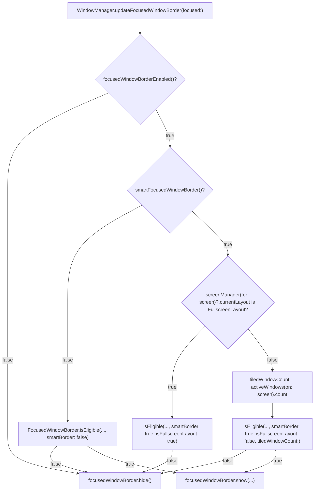

# Architecture & Technical Design

## 1. Overview & Invariants
- **Fit**: Extends the existing `FocusedWindowBorder` + `UserConfiguration` + `WindowManager.updateFocusedWindowBorder` pipeline, mirroring `smart-window-margins`.
- **Invariants**:
  1. `smart-focused-window-border` defaults to `false`; when `false`, border behavior and `WindowManager` work on the border path are unchanged.
  2. `FocusedWindowBorder.isEligible(...)` remains a pure function with zero AppKit/WindowServer side effects.
  3. Native macOS fullscreen (`spaceType != CGSSpaceTypeUser`) is always ineligible regardless of `smart-focused-window-border`.
  4. Floating windows are excluded from the tiled window count (`WindowManager.activeWindows(on:)` already filters out floating and hidden windows and checks `shouldBeManaged()`).

## 2. Domain Models, State & Interface Contracts
- **`UserConfiguration.ConfigurationKey`** (`Amethyst/Preferences/UserConfiguration.swift`):
  - Add `case smartFocusedWindowBorder = "smart-focused-window-border"`.
- **`UserConfiguration`** (`Amethyst/Preferences/UserConfiguration.swift`):
  - Add `func smartFocusedWindowBorder() -> Bool { return storage.bool(forKey: .smartFocusedWindowBorder) }`.
- **`Amethyst/default.amethyst`**:
  - Add `"smart-focused-window-border": false`.
- **`FocusedWindowBorder.isEligible`** (`Amethyst/View/FocusedWindowBorder.swift`):
  - Extend signature with defaulted parameters to preserve existing call sites and tests:
    ```swift
    static func isEligible(
        tracked: Bool,
        managed: Bool,
        spaceType: CGSSpaceType?,
        windowSpaceID: CGSSpaceID? = nil,
        screenSpaceID: CGSSpaceID? = nil,
        smartBorder: Bool = false,
        isFullscreenLayout: Bool = false,
        tiledWindowCount: Int? = nil
    ) -> Bool
    ```
  - Logic:
    1. Existing checks: `tracked && managed && spaceType == CGSSpaceTypeUser`, and optional `windowSpaceID == screenSpaceID`.
    2. If `smartBorder`:
       - Return `false` if `isFullscreenLayout`.
       - If `let tiledWindowCount = tiledWindowCount`, return `tiledWindowCount > 1`.
    3. Otherwise return `true`.
- **`WindowManager.updateFocusedWindowBorder(focused:)`** (`Amethyst/Managers/WindowManager.swift`):
  - Read `let smartBorder = userConfiguration.smartFocusedWindowBorder()`.
  - Only when `smartBorder` is `true` and `let screen = window.screen()`:
    - `isFullscreenLayout = screenManager(for: screen)?.currentLayout is FullscreenLayout<Application.Window>`
    - If `!isFullscreenLayout`, compute `tiledWindowCount = activeWindows(on: screen).count` (short-circuiting window enumeration when `FullscreenLayout` is already active).

## 3. Architecture Diagram & Data Flow


## 4. Boundary Rules & Budgets
- **Pure Core vs. I/O Shell**:
  - Pure Core: `FocusedWindowBorder.isEligible(...)` (pure boolean predicate, no WindowServer/AX/AppKit calls).
  - I/O & State Shell: `UserConfiguration` (reads `UserDefaults`/JSON storage), `WindowManager.updateFocusedWindowBorder` (queries `window.screen()`, `screenManager(for:)`, `activeWindows(on:)`, and drives `FocusedWindowBorder.show/hide`).
- **Concurrency, Latency & Resource Budgets**:
  - Matches `NFR-BORDER-1`: when `smart-focused-window-border` is `false` (default), zero extra calls are made. When `true` and `FullscreenLayout` is active, `activeWindows(on:)` is short-circuited.
  - `updateFocusedWindowBorder` continues to run on main thread (`guard Thread.isMainThread`).

## 5. Testing Strategy
1. **BDD Scenarios**: Map each `REQ-BORDER-*` and `NFR-BORDER-1` scenario in `specs/smart-focused-window-border/spec.md` to Quick/Nimble specs.
2. **Unit Tests (>= 95% coverage on touched core logic)**:
   - `UserConfigurationTests`: default `smartFocusedWindowBorder() == false` and override `true`.
   - `FocusedWindowBorderTests`: `isEligible` matrix covering `smartBorder: false/true`, `isFullscreenLayout: false/true`, `tiledWindowCount: 0, 1, 2, nil`.
3. **Mutation Testing (>= 95% kill)**:
   - Verify boundary mutations on `tiledWindowCount > 1` (`>= 1`, `> 0`, `== 1`), `smartBorder` guard, and `isFullscreenLayout` guard are all killed by unit assertions.

## Review Gate
- [x] **Gate 2 Approval**: Architecture & design reviewed and approved by human before task breakdown.
