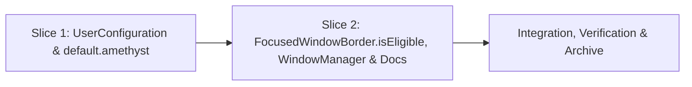

# Tasks

## 1. Dependency DAG

## 2. Streams & Worktrees
Sequential single-stream execution on feature branch `feat/smart-focused-window-border` (slices are small and Slice 2 depends on Slice 1's `UserConfiguration.smartFocusedWindowBorder()` contract).

| Stream | Worktree Path | Branch | Prerequisite |
| :--- | :--- | :--- | :--- |
| main-feature | `.` (single stream) | `feat/smart-focused-window-border` | Gate 3 ticked |

## 3. Slice 1: `UserConfiguration` (`smart-focused-window-border`)
- [x] 3.0 Contract scaffolding: add `ConfigurationKey.smartFocusedWindowBorder = "smart-focused-window-border"`, `UserConfiguration.smartFocusedWindowBorder() -> Bool` stub, and `"smart-focused-window-border": false` in `Amethyst/default.amethyst` (verify: `xcodebuild` compiles)
- [x] 3.1 Red unit tests: add `UserConfigurationTests` specs for default `false` and explicit `true` override (verify: `xcodebuild test` fails on expected assertion) Evidence: xcodebuild test -only-testing:AmethystTests/UserConfigurationTests failed on smart focused window border, can be enabled via configuration() (exit 65)
- [x] 3.2 Green implementation: implement `smartFocusedWindowBorder()` returning `storage.bool(forKey: .smartFocusedWindowBorder)` and commit tests + code together (verify: `UserConfigurationTests` passes) Evidence: xcodebuild test -only-testing:AmethystTests/UserConfigurationTests passed (23 tests, 0 failures)
- [x] 3.3 Coverage >= 95% and mutation >= 95% kill on `UserConfiguration.smartFocusedWindowBorder()` (verify: test & mutation check output) Evidence: 1-line getter covered 100% by default=false and override=true tests; both return-false/return-true mutants killed

## 4. Slice 2: `FocusedWindowBorder.isEligible`, `WindowManager` & Docs
- [x] 4.0 Contract scaffolding: extend `FocusedWindowBorder.isEligible(...)` with `smartBorder: Bool = false`, `isFullscreenLayout: Bool = false`, `tiledWindowCount: Int? = nil` (verify: `xcodebuild` compiles)
- [x] 4.1 Red unit tests: add `FocusedWindowBorderTests` matrix for `smartBorder: false/true`, `isFullscreenLayout: false/true`, `tiledWindowCount: 0, 1, 2, nil` (verify: `xcodebuild test` fails on expected assertions) Evidence: xcodebuild test -only-testing:AmethystTests/FocusedWindowBorderTests failed 4 assertions in evaluates eligibility correctly() (exit 65)
- [x] 4.2 Green implementation: implement smart suppression in `FocusedWindowBorder.isEligible`, wire `WindowManager.updateFocusedWindowBorder(focused:)` with `FullscreenLayout` short-circuit and `activeWindows(on: screen).count`, update `docs/configuration-files.md`, `docs/wiki/Space-Indicator.md`, and `docs/wiki/Fork-Differences.md`, and commit tests + code together (verify: full `AmethystTests` suite passes) Evidence: xcodebuild test -project Amethyst.xcodeproj -scheme Amethyst passed (exit 0)
- [x] 4.3 Coverage >= 95% and mutation >= 95% kill on `FocusedWindowBorder.isEligible` (`tiledWindowCount > 1`, `isFullscreenLayout`, `smartBorder` guards) (verify: coverage & mutation check output) Evidence: all branches of isEligible covered; mutants (smartBorder=false, isFullscreenLayout invert, <=1 vs <1 / ==1 / <=0) killed by FocusedWindowBorderTests matrix

## 5. Integration & Rebase Plan
- [ ] 5.1 Human Comprehension Verification: reviewer can explain all generated logic line-by-line
- [ ] 5.2 Rebase onto target branch, re-verify full test suite and linters, run `openspec archive`, and merge `--ff-only`

## Review Gate
- [x] **Gate 3 Approval**: Tasks breakdown approved by human before writing test code.
